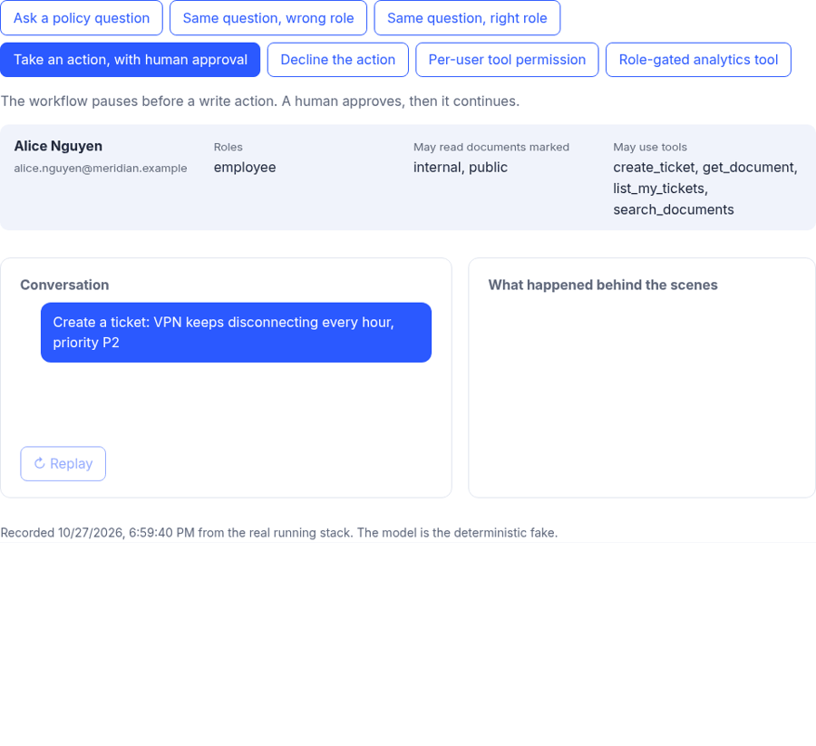
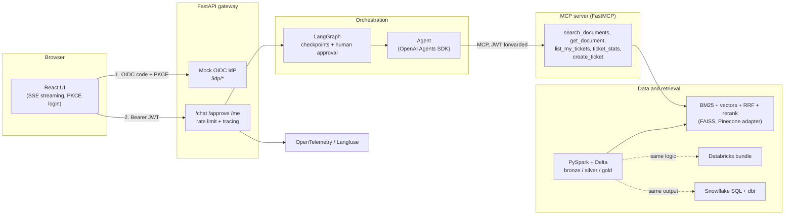
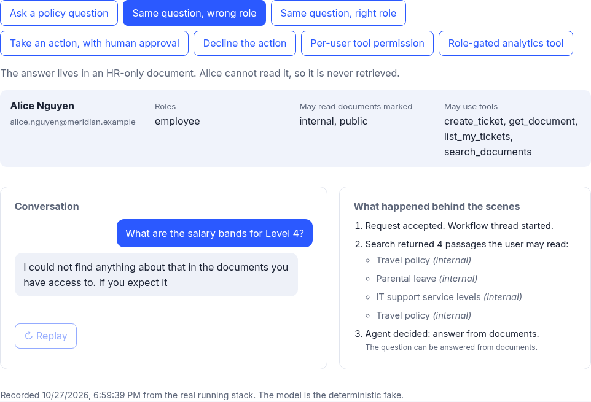
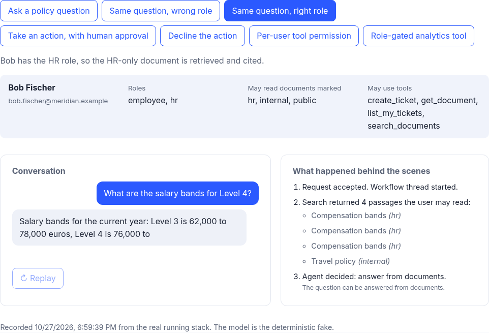
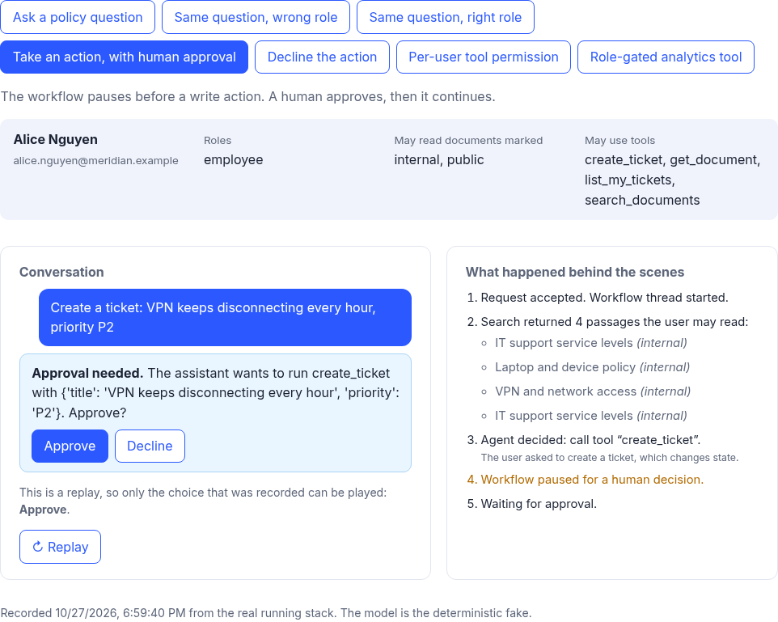
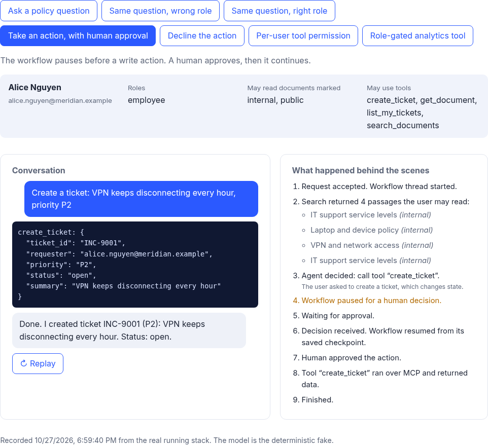

**▶ Live demo (recorded replay): https://ai-engineering-stack-demo.netlify.app/**

# ai-engineering-stack

A small but complete **enterprise knowledge copilot** for a fictional freight company, "Meridian Freight Co.". It exists to show, in one repository, every layer of a modern AI system working together: web front end, sign-in, access control, API gateway, workflow orchestration, an AI agent, tool servers (MCP), a data lakehouse (PySpark, Delta, Databricks, Snowflake), retrieval, evaluation, observability and production deployment.

[](https://github.com/tanvir-ux/ai-engineering-stack/actions/workflows/ci.yml)




## What it does, in plain English

You ask the assistant a question in everyday language. It searches company documents, **but only the ones you are allowed to read**, and answers with citations. If you ask it to do something that changes data (for example, open an IT ticket), it **pauses and asks a human to approve** before anything happens. Every step is traced, so you can see what it did and why.

Try the [recorded replay](https://ai-engineering-stack-demo.netlify.app/). It shows seven short scenarios, such as "same question, wrong role" (blocked) and "same question, right role" (answered). The replay is a recording of the real backend, so the hosted page makes no live calls and costs nothing to run. The same page also has a live mode that talks to a backend you run yourself (see [Run it](#run-it)).

## What this demonstrates

| Layer | What is here | Where |
| --- | --- | --- |
| Front end | React 18 + TypeScript + Vite. Streams the answer as it is produced, shows the trace, handles approvals, signs in with OIDC (authorization code + PKCE). | [`frontend/`](frontend) |
| Authentication | A mock OIDC identity provider (RS256 tokens, JWKS) so the whole flow runs offline. The API only accepts tokens it can verify. Swap in Keycloak, Auth0 or Entra ID with environment variables. | [`src/aistack/auth/`](src/aistack/auth) |
| Authorisation | Roles map to document classes and tool permissions. Per-user overrides can deny a tool even if the role allows it. | [`policy.py`](src/aistack/auth/policy.py) |
| API gateway | FastAPI with server-sent events, per-user rate limiting, request tracing, health and readiness checks, CORS. | [`src/aistack/gateway/`](src/aistack/gateway) |
| Orchestration | LangGraph workflow with durable checkpoints (SQLite) and a human-approval step that survives a restart. | [`src/aistack/orchestration/`](src/aistack/orchestration) |
| Agent | OpenAI Agents SDK. The model sits behind an interface: a deterministic fake runs in tests and CI; OpenAI or Gemini are one setting away. | [`src/aistack/agents/`](src/aistack/agents) |
| MCP | A FastMCP server that exposes the tools and checks the caller's JWT on every call. | [`src/aistack/mcp_tools/`](src/aistack/mcp_tools) |
| Data (local) | PySpark 4 with Delta Lake. Bronze, silver and gold tables, a quarantine for bad records, de-duplication, chunking, embeddings. | [`spark_pipeline.py`](src/aistack/data/spark_pipeline.py) |
| Data (Databricks) | A Databricks Asset Bundle that runs the same job logic on serverless compute. | [`databricks/`](databricks) |
| Data (Snowflake) | SQL for a vector table, a row-access policy that mirrors the app's rule, and a dbt project. | [`snowflake/`](snowflake) |
| Retrieval | BM25, hashed-vector search with FAISS, reciprocal-rank fusion, a reranker, and a Pinecone adapter. Access filtering happens **before** ranking. | [`src/aistack/retrieval/`](src/aistack/retrieval) |
| Evaluation | A 32-question golden set, a retrieval benchmark, an access-control leak test and an end-to-end agent eval. | [`src/aistack/eval/`](src/aistack/eval), [`evals/`](evals) |
| Observability | OpenTelemetry spans, with optional OTLP export and Langfuse hooks. | [`observability/`](src/aistack/observability) |
| Production | Dockerfiles, docker compose, Helm chart with a rendered Kubernetes manifest, Terraform AWS sketch, GitHub Actions CI. | [`deploy/`](deploy), [`.github/`](.github/workflows) |

## Architecture



Two rules hold the design together:

1. **The caller's identity travels all the way down.** The browser's token reaches the MCP server, which verifies it again and filters documents by the caller's roles. No layer trusts another to have checked.
2. **Anything that changes data needs a human.** The workflow stops at `awaiting_approval` and keeps its state in a checkpoint. A decision, even much later, resumes the same run.

## What is verified and what is not

"Executed" means it ran on the machine that built this repository, or in CI, and the check is part of the test suite or the Makefile. Nothing here has been run against a live Databricks workspace, Snowflake account, Pinecone index, AWS account or Kubernetes cluster, because those need accounts I have not connected. Those parts are labelled so.

| Layer | Status | How it is checked |
| --- | --- | --- |
| React front end | **Executed** | 10 vitest tests, `tsc`, production build, and a real browser run (screenshots in `docs/img`) |
| OIDC login, JWT verification, RBAC | **Executed** | 13 + 7 tests (the code-and-PKCE exchange is covered in `test_auth.py`), and a real PKCE login in `scripts/compose_smoke.py` and in a real browser |
| FastAPI gateway (SSE, rate limit, health) | **Executed** | 14 tests, 4 end-to-end integration tests |
| LangGraph orchestration, approval, resume | **Executed** | 8 tests, including resume after approve and decline |
| Agent (OpenAI Agents SDK) | **Executed with a fake model** | 8 tests. Live OpenAI or Gemini calls are **not** executed (no API key was used) |
| MCP server (FastMCP) | **Executed** | 9 tests, and the integration tests call it over HTTP with a real token |
| PySpark + Delta pipeline | **Executed locally** | 7 Spark tests (Spark 4.2.0, Java 21), real Delta tables written and read back |
| Databricks Asset Bundle | **Validated offline, not executed** | `databricks bundle validate` against a local stub of the workspace API (`scripts/validate_bundle.py`). It has not been deployed or run on Databricks |
| Databricks job logic | **Executed locally** | 3 tests run the same job code with a table-name mapper |
| Snowflake SQL | **Parsed, not executed** | Each SQL file is parsed with sqlglot. The dbt models run in DuckDB and are compared with the Spark output. The Snowpark loader runs against a fake session. Nothing ran in a Snowflake account (12 tests) |
| Retrieval (BM25, FAISS, RRF, rerank) | **Executed** | 11 tests and the benchmark below |
| Pinecone adapter | **Mock-tested** | Tested against a fake client, including "fails closed" with no readable classes. No live index. It is a library component and `scripts/pinecone_sync.py` is its entry point. The gateway searches the local index |
| Evaluation harness | **Executed** | `make eval`. Numbers below |
| Observability | **Executed locally** | OpenTelemetry spans are tested. OTLP export and Langfuse are wired but **not** exercised against a real collector |
| Docker images and compose | **Executed in CI only** | There was no Docker on the build machine. The `docker` CI job builds both images, runs `docker compose up` and runs the end-to-end smoke test |
| Helm chart and Kubernetes manifest | **Validated, not deployed** | `helm lint`, `kubeconform --strict`, a check that the committed manifest equals the rendered chart, and tests that load its settings with the app's own config class. Not applied to a cluster |
| Terraform (AWS) | **Validated, not applied** | `terraform fmt` and `terraform validate` in CI. It is a sketch and has never created a resource |
| CI | **Runs on every push** | See the badge. Jobs: python, frontend, platform-config, docker |

Totals at the time of writing: **106 Python tests** (96 without the Spark marker) and **10 front-end tests**. `ruff`, `mypy --strict`, `bandit` and `pip-audit` are clean.

## Measured results

All numbers come from `make eval` on the synthetic data in this repository. The golden set is small (32 questions, 65 chunks from 28 documents), so treat the numbers as a regression gate and a demonstration of the method. They are not a general benchmark.

**Retrieval** (`python -m aistack.eval.rag_eval`, full table in [`docs/EVAL_REPORT.md`](docs/EVAL_REPORT.md))

| Retriever | hit@1 | hit@3 | MRR |
| --- | --- | --- | --- |
| BM25 | 0.969 | 1.000 | 0.984 |
| Hashed vectors ("dense") | 0.719 | 0.938 | 0.818 |
| Hybrid (RRF) | 0.938 | 1.000 | 0.964 |
| Hybrid + rerank | 0.969 | 1.000 | 0.979 |

Honest reading: on this small, keyword-friendly dataset **plain BM25 is as good as or slightly better than the hybrid**. The "dense" retriever uses feature hashing, which is lexical, not a neural embedding. The hybrid pipeline earns its place when you swap in real embeddings (`OpenAIEmbedder`), which I have not run here.

**Access control** (same command): every golden question was asked as each of 5 roles, 160 searches. **0 forbidden chunks were returned.** 53 of 53 questions whose answer sits in a document the role may not read had that document withheld.

**Agent, end to end** (`python -m aistack.eval.agent_eval`, [`docs/AGENT_EVAL.md`](docs/AGENT_EVAL.md)): with the deterministic fake model, 0.875 of answers contain every expected fact, 0.969 cite a relevant document, and the median workflow latency is about 11 ms. Four questions fail (q07, q10, q24, q25). This model answers by quoting the retrieved text, so the figures check the plumbing (retrieval, tools, citations, workflow). They say nothing about how well a real language model would do.

**Data pipeline** (`artifacts/gold/pipeline_metrics.json`): 28 documents in, 28 clean, 0 quarantined, 65 chunks of 384 dimensions. 306 tickets in, 300 clean, 2 quarantined, 4 duplicates removed.

### Known limits

- The fake model gates "is this passage relevant" with a simple word-overlap threshold. Some off-topic questions can therefore receive a loosely related answer. I tried a stricter threshold and it made the agent eval worse, so I left it and chose demo questions that show the behaviour honestly.
- The mock identity provider is for development. In production, point `AISTACK_OIDC_ISSUER` and `AISTACK_OIDC_JWKS_URL` at a real provider. That path is covered only by tests that use the mock provider's keys.
- The Terraform file is a sketch: default VPC, no autoscaling, no remote state.
- The data is synthetic. No real customer or employee data is in this repository.

## Screenshots

| Wrong role: blocked | Right role: answered |
| --- | --- |
|  |  |
| **Paused for human approval** | **Approved, tool ran** |
|  |  |

## Run it

You need Python 3.12, Node 20, and (for the Spark parts) Java 17 or 21. [`uv`](https://docs.astral.sh/uv/) is the easiest installer.

```bash
make install          # venv, Python deps, npm ci
make test             # 106 Python tests + 10 front-end tests (about a minute)
make check            # ruff, mypy, tests, bandit, pip-audit
make eval             # rewrites docs/EVAL_REPORT.md and docs/AGENT_EVAL.md
```

Run the real stack on your machine (no API keys needed, the default model is the deterministic fake):

```bash
make dev-stack                                   # gateway :8010 (with the mock IdP) and MCP :8001
cd frontend && npm run dev                       # then open http://localhost:5173/?live=http://localhost:8010
python scripts/compose_smoke.py --base http://localhost:8010   # end-to-end check
```

Or with Docker: `docker compose up --build`, then open `http://localhost:8080/?live=http://localhost:8000`.

To use a real model, copy `.env.example` to `.env` and set `AISTACK_LLM_MODE=openai` (or `gemini`) and the key. Live model calls are not part of the tests.

Re-record the demo from a running stack: `make record`. The hosted replay is `frontend/public/recordings/*.json`, produced by `scripts/record_runs.py`.

### Personas in the mock identity provider

| Person | Roles | Notes |
| --- | --- | --- |
| alice | employee | Cannot read HR or finance documents |
| bob | employee, hr | Can read HR documents |
| carol | employee, finance | Can read finance documents |
| dave | employee, security | Can use the ticket statistics tool |
| eve | contractor | Public documents only, no tickets |
| farid | admin | Everything |
| hugo | employee | Role allows tickets, but a per-user rule denies `create_ticket` |

## Deployment

See [`deploy/README.md`](deploy/README.md) for the runbook: images, compose, Kubernetes (Helm), AWS (Terraform), secrets, health checks and rollback.

## What I need from a real account to go further

These are the steps I could not do without credentials. None is needed to run the repository.

| To prove this | What is needed |
| --- | --- |
| Databricks bundle runs for real | A Databricks workspace (the free edition is enough) and `databricks bundle deploy -t dev` ([`databricks/README.md`](databricks/README.md)) |
| Snowflake SQL and dbt run for real | A Snowflake account (a trial works) and the steps in [`snowflake/README.md`](snowflake/README.md) |
| A live language model | An OpenAI or Gemini API key |
| Pinecone retrieval | A Pinecone API key and an index (384 dimensions, cosine), then `python scripts/pinecone_sync.py` |
| Cluster and cloud deployment | A Kubernetes cluster, or an AWS account for the Terraform sketch |

## Related projects

Part of a set of small, working AI-engineering showcases:

- [agent-platform](https://github.com/tanvir-ux/agent-platform): one support task implemented with eight agent frameworks, plus MCP and A2A.
- [graphrag-service](https://github.com/tanvir-ux/graphrag-service): GraphRAG compared with vector RAG, with an evaluation harness.
- [llm-finetune-serve](https://github.com/tanvir-ux/llm-finetune-serve): LoRA fine-tuning and an OpenAI-compatible server.

## Licence

[MIT](LICENSE). Copyright Md Tanvir Alam.
